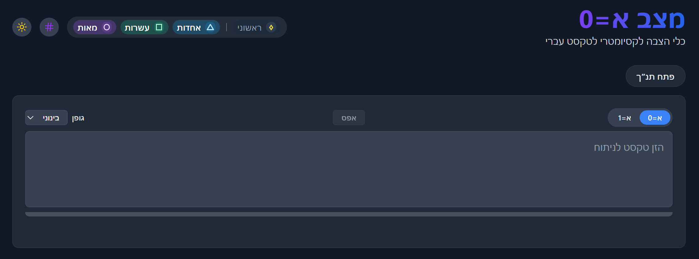

# Aleph Efes (AlephEfes, א=0 / א=1) — quantitative textual and compositional analysis of the Hebrew Bible

**Aleph Efes** is an open-source research project by **Edan-David Eyon** (GitHub: **EdanDa**). This repository, **EdanDa/AlephEfes**, contains the Aleph Efes calculator, a built-in Tanakh corpus, tests, corpus-generation tools, reproducible research code, and research documentation for the **א=0 / א=1** alphabetic system.

**Project site:** https://aleph-efes.vercel.app/  
**GitHub repository:** https://github.com/EdanDa/AlephEfes

Aleph Efes maps the traditional 22-letter Hebrew order onto a paired zero-/one-based alphabetic coordinate system, normalizes final letter forms to their base letters, and extends the sequence through three additive decimal layers: **Units, Tens, and Hundreds**.

The project began from a minimal indexing shift:

```text
If ב is counted as 1,
the preceding coordinate is א=0.
```

That gives:

```text
א=0, ב=1, ג=2, ... ת=21
```

The mapping was fixed before the textual structures described in the research were found.

At the current stage of the project, recurring structures across independently bounded biblical units support the identification of a **selectively deployed compositional mechanism consistent with the א=0 table**. Lexical values repeatedly function not only as word values but as textual measures: section lengths, local positions, centers, boundaries, repetition counts, occurrence addresses, and transition points.

The open historical questions concern **where the technology originated, how it was calibrated and transmitted, which scribes or institutions knew it, and where in the corpus it was or was not used**.

The calculator interface is currently in **Hebrew**. An English interface is planned.

> You can use the app directly here:
> https://aleph-efes.vercel.app/

---



---

## What you can do with the calculator

AlephEfes provides five main analysis workspaces:

* **Lines (פירוט)**
  Line-by-line and word-by-word analysis, including U/T/H values, line totals, grand totals, digital roots, exact word positions, and unique-word presentation.

* **Clusters (קבוצות)**
  Digital-root neighborhoods with search, interactive cards, and relation highlighting.

* **Hot Words (שכיחות)**
  Frequency analysis by values or exact word forms, with sortable tables and value → word drill-down.

* **Graph (גרף)**
  Compares occurrence counts with distinct word-form counts for each value, with explicit layer coverage and complete word drilldowns.

* **Network (רשת)**
  Interactive force-directed graph connecting words to their visible U/T/H values.

Additional capabilities include:

* **א=0 / א=1 comparison modes**
* **U / T / H layer filtering**
* **digital-root grouping**
* **prime-value highlighting and filtering**
* **full Tanakh navigation**
* **Masoretic-section selection and ranges**
* **persistent input through `localStorage`**
* **dark mode and text-size controls**
* **virtualized long lists**
* **Web Worker-backed computation with main-thread fallback**

---

## Running the calculator

Requires Node.js 20+ and npm for development and browser checks.

### Verification

The app and unit tests share one reducer. Browser regressions run against the production build and cover input integrity, calculation recovery, stale-result guards, export agreement, source restoration, keyboard controls, and mobile layouts in both themes and numerical modes.

```powershell
$env:MAM_PARSED_PATH = "C:/path/to/MAM-parsed"
$env:MAM_BASICS_PATH = "C:/path/to/MAM-basics"
npm run check
npx playwright install chromium
npm run test:browser
```

On Windows, an installed Chrome can be used with `$env:PLAYWRIGHT_CHROMIUM_CHANNEL = "chrome"`. The source paths must point to the pinned MAM revisions listed in the CI workflow. CI runs both the quality checks and browser suite, and retains mobile screenshots and failure traces as artifacts.

`lint` is a lightweight log-policy check. The historical `typecheck` command validates JavaScript and JSX syntax; it does not perform static type analysis. Production compilation, unit/corpus tests, and browser tests provide separate checks.

Saved working sessions use version 2 of the `alephEfes:session` local-storage record containing the text, calculation mode, MAM selection, and workspace preferences (view, layers/prime filter, and text size). Version 1 sessions and existing `alephCodeText` migrate automatically; theme settings retain their existing key. Manual text changes clear the MAM association. Exported analyses record the selected mode and filters in JSON metadata and CSV columns; pinned exports use the same filtered set in every format. Value-map `topWords` groups each word once with its matching `layers` array, and occurrence totals count each text occurrence once per value.

The groups view mounts only nearby rows, while searches and exports use every analyzed word. The network computes its layout in a separate worker, pauses offscreen, and offers Pause/Resume; a failed worker leaves an interactive static layout. Copy, CSV, and JSON are available from each panel's export menu.

For repeatable production-build profiling, start Vite preview on port 4188, set `PLAYWRIGHT_CHROMIUM_CHANNEL=chrome` if using installed Chrome, and run `node scripts/browser-benchmark.mjs`. It records five Genesis runs and their medians under `.cache/verification/`. Run it without other browser suites competing for CPU; `BENCHMARK_URL` can select a different preview URL.

The **בדוק מילה** action opens a word inspector from groups, details, frequency results, and graph selections. Counts use exact normalized spelling across the complete current passage, independently of display filters. Final-letter spellings stay distinct. Optional positions start at one; letter positions count only canonical calculation letters. An even-length unit has its center between two elements. Manually entered text has original line-relative positions and no inferred MAM attribution.

**הערת מחקר** is available in each result panel's export menu and inside the word inspector. Preview, Copy, and Download `.md` use a single Markdown generator. A note covers one MAM unit or one selected manual-input line. Book/range analyses require an explicit unit choice when none has been inspected. Notes include exact calculation text, mode and display filters, occurrence/form counts, one-based positions, selected word/value, verified source identifiers and hashes, and corpus attribution. Word lists are complete inside the chosen unit; a corpus-wide search includes its total and selected occurrence and explicitly labels the unit as an excerpt. Existing quick Copy, CSV, JSON, corpus files, and their schemas are unchanged.

Corpus search is explicit and lazily fetches the existing occurrence index. Results are grouped by book and MAM section; inspecting a result does not replace the main analysis. Loading its section requires the separate **טען פרשיה זו לניתוח הראשי** action. Book text, provenance, manifest, and occurrence index are checked against build-pinned SHA-256 hashes before use; failed loads have retry controls. `npm run corpus:generate` regenerates the research integrity file, and `npm run corpus:check` verifies it. Existing corpus downloads retain their formats and numerical definitions.

### Installing on Android

Open [Aleph Efes](https://aleph-efes.vercel.app/) in Chrome, then choose **⋮ → Add to Home screen → Install** when offered. Chrome may also show an install promotion after you interact with the page and spend time on it. The installed app opens in its own window and uses the same saved text as the website. An internet connection is required to load the app and fetch corpus data.

Installation metadata lives in `public/manifest.webmanifest`, with 192px and 512px icons and a separate maskable Android icon in `public/icons/`.

### First-time setup

```bash
git clone https://github.com/EdanDa/AlephEfes.git
cd AlephEfes
npm install
npm run dev -- --host
```

### Subsequent updates

```bash
cd AlephEfes
git pull
npm install
npm run dev -- --host
```

### Alternative start commands

```bash
git clone https://github.com/EdanDa/AlephEfes.git
cd AlephEfes
npm install

# Option 1:
npm start

# Option 2:
npm run dev
```

By default:

```text
npm run dev → http://localhost:5173
npm start   → http://localhost:4173
```

The app stores the last analyzed text locally for convenience.

---

## Structure

```text
├── index.html
├── src/
│   ├── App.jsx
│   ├── main.jsx
│   ├── components/
│   │   ├── TanakhNavigator.jsx
│   │   └── VirtualizedList.jsx
│   ├── core/
│   │   └── analysisCore.js
│   ├── state/
│   │   ├── appReducer.js
│   │   └── appStore.jsx
│   └── workers/
│       └── coreResults.worker.js
├── tests/
│   ├── analysisCore.test.js
│   ├── appReducer.test.js
│   └── tanakhCorpus.test.js
├── scripts/
│   ├── check-corpus-bundle.mjs
│   ├── generate-tanakh-corpus.mjs
│   └── validate-tanakh-corpus.mjs
├── public/corpus/
│   ├── manifest.json
│   ├── provenance.json
│   └── books/*.json
├── docs/
│   └── demo.png
├── package.json
└── vite.config.js
```

---

## Built-in Tanakh corpus

AlephEfes includes a generated, read-only Tanakh corpus derived from the local `MAM-parsed/plus` source.

Open **פתח תנ״ך** to select:

```text
תורה
נביאים
כתובים
```

and then load:

* a complete book;
* one ordered Masoretic section;
* or a continuous range of sections.

Selections enter the same calculation engine as manually pasted text.

For multi-section input, each genuine Masoretic section remains a separate analytical line.

The complete corpus can also be downloaded as one JSON file from the Tanakh navigator header. The same generated artifact is stored at:

```text
public/corpus/aleph-efes-tanakh-corpus.json
```

It contains the manifest, provenance and attribution metadata, and all 24 book payloads.

The download contains `analysisShared` plus fully populated `analysisByMode["aleph-zero"]` and `analysisByMode["aleph-one"]` value tables, generated by the same calculation engine as the app. Both cover all 305,437 word occurrences and 4,039 sections, with U/T/H values, digital roots, prime flags, letter tables, and corpus/section totals.

In **analysis schema 2.0.0**, the 39,650 word spellings and frequency counts appear once in `analysisShared.words`. Ordered `wordIndices` appear once in `analysisShared.sections`; they are zero-based indices into the shared dictionary. Each mode's `wordValues[wordIndex]` holds the numerical record for the corresponding shared word. Each mode's `sections[sectionIndex]` holds the totals for the corresponding shared section; `analysisShared.sections[sectionIndex].sectionId` joins it to the original book section. This replaces the duplicated `analysisByMode[mode].words` and per-mode `wordIndices` in analysis schema 1.0.0.

**Distribution semantics:** `drDistribution` counts unique word forms, so its ten buckets sum to **39,650**, including the zero-root bucket. It gives each spelling one vote regardless of frequency. `drDistributionBasis` explicitly records `unique-word-forms`. The additional `drOccurrenceDistribution` weights each word by its frequency and sums to **305,437**. Both distributions are specific to the selected numerical mode.

`contentHash` still identifies the unchanged original book payloads. `sharedAnalysisHash` is the SHA-256 of `JSON.stringify(analysisShared)`. `analysisHash` hashes `JSON.stringify({ analysisShared, analysisByMode })` in the stored key order.

Two separate research indexes are linked from the same navigator header and declared in `manifest.downloads`:

* `wordOccurrencesJson` → `aleph-efes-tanakh-word-occurrences.json`: `occurrencesByWord[word]` directly lists every occurrence as `[sectionIndex, wordPosition]`, in corpus order. `sectionIndex` is zero-based into `sectionIds` and `analysisShared.sections`; `wordPosition` is one-based within the MAM section.
* `tokenLocationsJson` → `aleph-efes-tanakh-token-locations.json`: maps every calculation token to its exact selected MAM verse. Each section has consecutive `verseSpans` with fields `[startWordPosition, wordCount, verseIndex, verseStartWordPosition]`. `verseIndex` is zero-based into `verseLocators`, whose records preserve `book24`, `subBook`, `chapter`, and `verse`. Both word positions are one-based; verse positions count the ketiv-only calculation stream and continue across a genuine MAM boundary inside a verse. A span covers positions from `startWordPosition` through `startWordPosition + wordCount - 1`; a token's verse position is `verseStartWordPosition + wordPosition - startWordPosition`.

The indexes carry attribution/provenance and both `contentHash` and `sharedAnalysisHash` so researchers can verify that they match the downloaded corpus. Verse spans retain exact token assignments without repeating the same locator for every token. They are derived during MAM conversion, after ketiv selection and token normalization, and checked against every upstream verse. Locator metadata does not change the analytical section boundaries.

### Text and structure policy

The corpus follows a strict textual policy:

* **Ketiv only.**
* Qere readings without written Ketiv contribute no calculation text.
* Written Ketiv remains even when it is not read.
* When an omitted Qere carries the maqaf that separates the selected Ketiv from the following word, that word boundary is retained as a plain space; Qere text and its maqaf remain omitted.
* Cantillation and vocalization do not affect the consonantal calculation stream.
* Punctuation and maqaf do not create numerical content.
* Final letter forms are preserved in source representation but normalized mathematically to their base letters.
* Chapter and verse references are retained as locators only.
* Analytical divisions follow genuine Masoretic section boundaries rather than chapter or verse divisions.
* A genuine section boundary inside a verse remains a boundary.
* The defined Masoretic spacing before the later prophets of the Twelve and the later internal books of Psalms closes the preceding section; its initial occurrence does not create an empty section.
* Poetic spacing is distinguished from section structure rather than inferred mechanically from every layout marker.
* Ambiguous or special upstream boundary types remain explicitly recorded rather than silently collapsed into ordinary open or closed sections.

At the pinned source revisions, the corpus contains 4,039 nonempty sections and 4,015 genuine boundaries. The exact markers comprise 1,553 `פפ`, 18 `פפפ`, 1,554 `סס`, 428 genuine `ססס`, 328 `מ:ששש`, 34 documented poetic `ר1`, 47 documented poetic `ר3`, 38 documented poetic `ר4`, 11 `מ:רווח בתרי עשר בפסוק הראשון`, and 4 `מ:רווח לספר בתהלים בפסוק הראשון`. Their normalized structural types are 1,656 open, 2,016 closed, 328 distinct shirah-setumah-like, and 15 Masoretic book-part spacing boundaries.

Exact provenance, source-marker interpretation, and boundary taxonomy are recorded in:

```text
public/corpus/provenance.json
```

### Source, attribution, and license

The biblical corpus is based on **MAM - Mikra According to the Masorah**, via **MAM-parsed**:

* [Mikra According to the Masorah - Hebrew Wikisource](https://he.wikisource.org/wiki/מקרא_על_פי_המסורה)
* [MAM-parsed](https://github.com/bdenckla/MAM-parsed)

The corpus is provided under **CC BY-SA 4.0**.

Credit:

* Seth (Avi) Kadish
* Erel Segal-Halevi
* Benjamin Denckla
* Hebrew Wikisource contributors

MAM documentation was consulted to interpret nontrivial source constructs. Its code was not copied into AlephEfes.

---

# Research framework

## 1) The fixed א=0 system

Let the 22 Hebrew base letters occupy the traditional Northwest-Semitic order:

```text
א ב ג ד ה ו ז ח ט י כ ל מ נ ס ע פ צ ק ר ש ת
```

with zero-based positions:

```text
א=0, ב=1, ג=2, ... ת=21
```

Final forms normalize to their base letters:

```text
ך → כ
ם → מ
ן → נ
ף → פ
ץ → צ
```

Three additive layers are used.

### U / Units

The raw zero-based alphabetic index:

```text
א=0
ב=1
ג=2
ד=3
ה=4
ו=5
ז=6
ח=7
ט=8
י=9
כ=10
ל=11
מ=12
נ=13
ס=14
ע=15
פ=16
צ=17
ק=18
ר=19
ש=20
ת=21
```

### T / Tens

The same order expanded at the decimal threshold:

```text
א=0 ... י=9
כ=10
ל=20
מ=30
נ=40
ס=50
ע=60
פ=70
צ=80
ק=90
ר=100
ש=110
ת=120
```

### H / Hundreds

The upper decimal threshold is expanded again:

```text
א=0 ... י=9
כ=10 ... ר=100
ש=200
ת=300
```

For concatenated strings `x` and `y`:

```text
U(xy) = U(x) + U(y)
T(xy) = T(x) + T(y)
H(xy) = H(x) + H(y)
```

and:

```text
U(w) ≡ T(w) ≡ H(w) mod 9
```

Digital-root conservation across U/T/H is therefore a **formal property of the system**.

---

## 2) Algebraic formulation

Let:

```text
Σ = the 27 modern Hebrew surface letter forms
Γ = the 22 normalized base letters
```

and let:

```text
ν : Σ → Γ
```

normalize final forms.

Extending by concatenation gives:

```text
ν* : Σ* → Γ*
```

For each mode `j ∈ {0,1}`, the three letter-value rows define an additive map into:

```text
ℕ₀³
```

and therefore a unique monoid homomorphism:

```text
Φ_j : Σ* → ℕ₀³
```

with canonical factorization:

```text
Σ*
 ↓ ν*
Γ*
 ↓ Parikh
ℕ₀^Γ
 ↓ V_j
ℕ₀³
```

Thus the numerical triple depends on normalized letter multiplicities.

For א=0:

```text
Φ₀(א) = (0,0,0)
```

so Aleph is orthographically present but arithmetically null.

This is a modern mathematical description of the system. The corresponding historical technology requires only:

```text
ordered alphabet
+ zero-based first coordinate
+ units / tens / hundreds
+ additive word values
+ counting of textual positions and units
```

---

## 3) Aleph as a null generator

Under א=0:

```text
U(א)=T(א)=H(א)=0
```

so:

```text
Φ₀(xאy)=Φ₀(xy)
```

for any surrounding strings `x,y`.

This produces lexical equivalences such as:

```text
דם / אדם
מת / אמת
בריה / בריאה
מלך / מלאך
מלכה / מלאכה
שרה / אשרה
בן / אבן
אלהים / מילה
```

---

## 4) Orthography as a measurable variable

Biblical Hebrew preserves genuine orthographic variation:

```text
defective / plene spelling
matres lectionis
variant foreign-name spellings
competing inherited forms
```

Under א=0, these changes have predictable numerical effects.

For common matres:

```text
א → +0
ה → +4
ו → +5
י → +9
```

### Aleph

Aleph can change the visible form without changing the numerical coordinate:

```text
שרה ↔ אשרה
```

### Yod

Yod shifts all three layers by 9 while preserving residue mod 9.

For example:

```text
ירושלם
→
ירושלים
```

changes:

```text
H=364
→
H=373
```

while preserving the digital-root class.

### Waw

Waw shifts the exact value by 5 and also changes the mod-9 class.

For historically variable spellings such as:

```text
מרדך
מרדוך
```

the alternative orthography supplies a genuine counterfactual.

This creates a direct historical test:

> **When scribes had multiple legitimate spellings available, do canonical choices systematically create, preserve, or avoid specific numerical coordinates?**

---

# Evidence and methodology

The fixed mapping produces lexical and textual coordinates such as:

```text
יהוה     = 22 / 22 / 22
שמש      = 52 in U
לבנה     = 29 in U
ירושלם   = 364 in H
מלאכתו   = 365 in H
```

Some of these align with independently meaningful quantities:

```text
52  ↔ whole weeks in a solar year
29  ↔ whole days in a synodic month
354 ↔ lunar-year scale
364 ↔ 52×7 week-year
365 ↔ solar/civil-year scale
110 ↔ Egyptian ideal completion age
120 ↔ Mesopotamian and biblical human-life limit
```

The strongest evidence occurs when a fixed value also becomes part of the measurable construction of a relevant textual unit:

```text
value ↔ section length
value ↔ local position
value ↔ center
value ↔ boundary
value ↔ repetition count
value ↔ occurrence index
value ↔ orthographic transition
value ↔ relation between adjacent units
```

The evidential target is a multi-channel assembly in which independently meaningful textual or external features converge, especially:

```text
fixed textual boundary
+
lexical value
+
exact length or position
+
center, boundary, or transition
+
local semantic relevance
```

Formal consequences such as Aleph-nullity, anagram equality, cross-layer mod-9 conservation, and digital-root preservation are not independent evidence of historical use by themselves.

---

# Representative textual assemblies

## Genesis 1:1–2:3

The seven inherited daily units contain:

```text
52, 38, 69, 69, 57, 149, 35 words
```

with:

```text
U(שמש)=52
U(ירח)=35
```

so the first and seventh daily units occupy the solar and lunar values.

Day 1 is centered on:

```text
ויהי | אור
```

Day 4, the central luminary unit, activates the same 35 and 52 coordinates internally and contains additional calendrical relations.

Through the end of the seven creation units:

```text
אלהים occurs 35 times
```

while:

```text
U(אלהים)=36
```

and its 36th occurrence is the first immediately beyond the creation boundary, inside:

```text
יהוה אלהים
```

The resulting assembly combines:

```text
fixed section boundaries
+ solar/lunar values
+ exact centers
+ local positions
+ divine-name counts
+ calendrical vocabulary
```

### Randomization test

A broad Monte Carlo test preserved:

```text
the Hebrew text
the seven fixed units
the 22 zero-based slots
the U/T/H construction
the relevant external constants
```

while randomly reassigning Hebrew letters to the 22 positions.

The canonical mapping scored:

```text
9 / 9
```

Across:

```text
200,000,000
```

random mappings:

```text
maximum random score = 5 / 9
```

and no random mapping reached 6/9.

With the standard Monte Carlo +1 correction:

```text
p_MC = 1 / 200,000,001
     ≈ 5.0 × 10^-9
```

The tested feature families were developed during the research rather than preregistered, so this is not a universal probability for the historical hypothesis.

It establishes a narrower result:

> under the defined randomization null, the observed creation architecture depends very strongly on the canonical assignment of Hebrew letters to the zero-based coordinates.

The individual conditions are often not especially rare. What random mappings failed to reproduce was the **combined assembly**.

---

## Babel

Genesis 11:1–9 contains:

```text
121 = 11² words
```

and is centered exactly on:

```text
האדם
```

giving:

```text
60 | האדם | 60
```

The YHWH descent verse contains 11 words, places יהוה at word 52, and ends at the central `האדם`.

There are also 11 words with digital root 4 before `האדם` and 11 after it, for a total of 22. Both `יהוה` and `בבל` belong to the same digital-root class.

Because the unit concerns:

```text
language
shared speech
collective coordination
and linguistic fragmentation
```

its alphabetic and positional architecture is directly relevant to its subject.

---

## Abraham, Isaac, Sarah, Heth, and Ephron

Several independently bounded units form a connected numerical assembly.

```text
חת = 28 / 127 / 307
```

while:

```text
Sarah's age             = 127
first לך לך unit length = 127
Aqedah unit length      = 307
```

The Aqedah contains:

```text
יצחק = 51 / 186 / 186
```

with:

```text
word 51  = יצחק
word 186 = ידך
```

inside:

```text
אל תשלח ידך אל הנער
```

The final explicit occurrence of `יצחק` is also the exact center of the 307-word unit.

Genesis 23 contains:

```text
275 words
```

while:

```text
עפרון = 68 / 275 / 275
```

and the same unit links Sarah's 127 years, Heth, Ephron, the transfer of the burial property, and the preceding Aqedah.

This is a compact example of numerical value functioning as **measure, address, and compositional relation** rather than merely lexical total.

---

## Cross-book replication

The same operational grammar appears outside Genesis.

### Exodus

```text
אהיה = 17 / 17 / 17
```

and the formula:

```text
אני יהוה
```

occurs 17 times.

The first exact `יהוה` in the burning-bush unit occurs at local word:

```text
22
```

while:

```text
יהוה = 22 / 22 / 22
```

Other Exodus units coordinate divine identity, departure, Sabbath, sanctuary, and transition through exact lengths, counts, positions, and centers.

### Joshua

Under א=0:

```text
U₀(יהושע)=53
```

The exact form `יהושע` occurs:

```text
159 = 3×53
```

times in the book.

The opening Masoretic unit also contains:

```text
159 words
```

and is centered on:

```text
אהיה עמך
```

This creates an independently bounded assembly:

```text
protagonist value
↔ protagonist count
↔ section length
↔ semantic center
```

### Daniel

Daniel demonstrates that the mechanism can survive Hebrew/Aramaic transition.

In Daniel 7:

```text
H₀(עשר)=360
```

at the exact center of one vision unit.

A following interpretive unit is centered on `עתיק` and contains:

```text
H₀(מלכותא)=365
```

while null final Aleph gives:

```text
Φ₀(מלכותא)=Φ₀(מלכות)
```

The local architecture links 360/364/365 to explicit language of time and kingship.

### Lamentations 2

Lamentations 2 contains 22 alphabetic units.

The first 21 contain:

```text
364 words
```

so the Tav unit begins at:

```text
word 365
```

with the local boundary containing:

```text
360 → ביום
364 → final word before Tav
365 → opening of Tav
```

while:

```text
H₀(ירושלם)=364
T₀(אשמרות)=365
```

inside a poem concerned with Jerusalem, day, night, appointed time, Sabbath, and festival.

Across different books, genres, and languages, the recurrent operation is:

```text
lexical value
→ textual measure or address
→ locally relevant structure
```

---

# Self-indexing and occurrence addresses

A word reaching its own numerical occurrence number is not evidence by itself.

In a sufficiently large corpus, any frequent word can eventually reach:

```text
occurrence_V(w)
```

The occurrence number is therefore treated as an **address** whose evidential value depends on what occurs there.

Structurally relevant activations include:

```text
first or last orthographic form
change of naming regime
section boundary
center
semantic realization
narrative operation
```

Thus:

```text
value
→ address
→ independently meaningful textual event
```

is stronger than self-indexing alone.

---

# Historical context and calibration hypothesis

The relevant scribal ecology connected Egypt, the Levant, Syria, and Mesopotamia and made available the operations required by the reconstructed system: alphabetic ordering, additive numeration, textual counting, orthographic variation, divine-name equivalence, and cross-script recoding.

The historical problem is how these operations were combined, calibrated, and transmitted.

---

## Ugarit: five writing systems, eight languages

Ugarit is especially important because an unusual concentration of relevant scribal technologies is documented in one Late Bronze Age center.

Its archives preserve **eight languages written through five graphic systems**:

```text
1. Sumero-Akkadian cuneiform
2. Ugaritic alphabetic cuneiform
3. Hittite hieroglyphs
4. Egyptian hieroglyphs
5. Cypro-Minoan
```

Ugaritic scribes worked with:

```text
alphabetic texts
syllabic cuneiform
lexical lists
god lists
administrative records
diplomatic correspondence
ritual and mythological texts
multiple sign inventories
and cross-cultural equivalence traditions
```

The Ugaritic Abgad belongs to the same Northwest-Semitic alphabetic order continued by Phoenician and Hebrew.

Alongside the standard expanded Ugaritic alphabet, evidence also survives for a shorter **22-sign alphabetic tradition**.

Seven-day sequences recur as compositional units in Ugaritic mythological literature.

The concentration in one scribal environment of fixed alphabetic order, alternative inventories, five writing systems, eight languages, Mesopotamian scholarship, god-name equivalence, numerical traditions, and structured literary composition makes Ugarit especially relevant to the history of calibration.

---

## Additive decimal numeration

Egyptian hieratic numeration was decimal and additive, using distinct signs for:

```text
1–9
10–90
100–...
```

rather than positional place value.

Israelite and Judahite scribes demonstrably used hieratic numerical traditions alongside Hebrew writing.

The operation:

```text
ordered signs
+
units
+
tens
+
hundreds
+
addition
```

was therefore historically available in the relevant scribal world.

Later Greek alphabetic numerals independently demonstrate that alphabetic order and additive decimal valuation can be combined directly.

---

## Divine numbers and the calibration hypothesis

Mesopotamian scholarly traditions assigned conventional numbers to major deities, including:

```text
Adad      → 6
Shamash   → 20
Sin/Nanna → 30
Ea/Enki   → 40
Anu       → 60
```

Under the canonical Northwest-Semitic order indexed from zero:

```text
אדד  → U₀=6
ננה  → U₀=30
אנקי → U₀=40
```

and:

```text
T₀(אן)=H₀(אן)=40
```

so:

```text
U₀(אנקי)=T₀/H₀(אן)=40
```

These correspondences arise under one fixed alphabetic order and one fixed valuation rule.

Together with the wider Ugaritic environment, they motivate a specific historical hypothesis:

> **Numerical calibration may have participated in the stabilization, selection, or recoding of the alphabetic system itself, rather than being applied only after the alphabet had already assumed its canonical form.**

The hypothesis can be tested against larger predefined sets of:

```text
historically attested divine names
available spellings
known divine numbers
alternative transliterations
and alternative alphabetic assignments
```

The relevant object is the **combined concentration of independently inherited correspondences**, not any isolated divine-name equality.

The absence of a surviving instruction explicitly defining א=0 is not evidence against calibration; the hypothesis should be judged against contradictory evidence and competing models capable of explaining the same convergence.

---

## Scribal recoding

Ancient Near Eastern writing repeatedly separates:

```text
graphic presence
phonetic realization
lexical identity
categorical function
numerical function
```

The cuneiform sign:

```text
𒀭 / AN / DINGIR
```

can participate in several roles involving heaven, deity, divine classification, non-pronounced written marking, and the numerical tradition associated with Anu.

The comparison with Aleph is functional rather than genealogical. It demonstrates that ancient scribal systems could assign graphic, phonetic, categorical, and numerical functions to the same sign without requiring them to coincide one-to-one.

Multilingual scribal environments likewise show systematic recoding of names, gods, concepts, and written forms across representational systems, providing a historical setting in which number could function as one constraint among others on written representation.

---

# א=1 as a comparison mode

The one-based system remains analytically useful:

```text
א=1, ב=2, ... ת=22
```

For any word:

```text
U₁(w)=U₀(w)+L(w)
```

where `L(w)` is normalized letter length.

Comparison distinguishes:

```text
patterns specific to zero indexing
patterns specific to one-based counting
patterns shared by both
```

The two modes therefore function as comparative systems rather than interchangeable explanations.

---

# Research status and falsifiability

AlephEfes is a naturalistic historical research project.

The Hebrew Bible is treated as a composite human corpus produced and transmitted through:

```text
multiple authors
multiple editors
competing traditions
textual variants
orthographic change
later intervention
and long transmission histories
```

A historical א=0 technology therefore need not be uniformly present or equally understood throughout the text. Its transmission could involve designers, trained or partial users, conservative copyists, later editors, and writers unaware of the system.

The next stage of research is distributional:

```text
Where is the mechanism active?
Which operations recur?
Where is it absent?
Which variants preserve or disrupt it?
Which historical environments best explain its calibration and transmission?
```

Historical reconstructions involving specific population identities, precise transmission routes, foreign-name recodings, pantheon transformations, and the exact origin of calibration remain distinct from the measurable textual architecture.

The project is best approached as a **system-identification problem**:

```text
fixed mapping
→ formal outputs
→ textual geometry
→ external calibration
→ repeated compositional activation
→ historical reconstruction
```

The first stages are mathematical and reproducible; historical attribution is abductive.

The historical importance of the biblical corpus is independent of AlephEfes. If a previously unidentified alphabetic-number technology participated in the composition or editing of parts of it, its significance lies in what it reveals about **how one of history's most consequential textual corpora was constructed**.

The project remains open to replication, criticism, counter-models, falsification, revision, and replacement by a stronger explanation.

The central task is not to accumulate numerical coincidences. It is to identify — or successfully disprove — the recurrent compositional mechanism.

---

## License

MIT

---

## Author

Developed by **Edan-David Eyon**
Independent researcher, Israel

I have pursued independent study across philosophy, linguistics, history, mathematics, cognition, and related fields since 2011.

The editor and both numerical mode buttons remain available at all times; older saved editor-collapse preferences are ignored. The views are labelled גרף and רשת. The graph compares occurrence totals with distinct word-form counts for each numerical value, provides selection of every value, and lists all matching word forms with pagination. Layer coverage is descriptive; it is not a statistical significance test.
